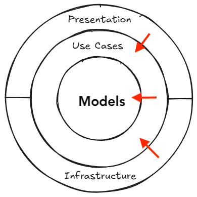

## Отчет
*Выполнил Андреев Никита Алексеевич*

## Запуск

```zsh
dotnet build
dotnet run --project HW2.Host/      # запуск приложения из HW2/HW2/
dotnet test     # запуск юнит-тестов из HW2/HW2/
```

## Команды самого приложения

| Команда | Что делает                                                                                         |
|---|----------------------------------------------------------------------------------------------------|
| `student add` / `student list` | добавить студента / показать список всех студентов                                                 |
| `criteria add` / `criteria list` | добавить критерий / показать список всех критериев                                                 |
| `evaluation set` | выставить оценку студенту по критерию (если оценка уже есть, она исправляется)                     |
| `evaluation list` | показать все оценки                                                                                |
| `evaluation delete` | удалить оценку                                                                                     |
| `evaluation calculate final` | итог одного студента                                                                               |
| `evaluation calculate all` | итоги всех студентов                                                                               |
| `evaluation export final` | экспорт итогов в файл                                                                              |
| `evaluation import gradebook` | импорт ведомости из JSON-файла                                                                     |
| `demo` | сквозной сценарий: завести студентов и критерии → выставить оценки → получить итог → экспорт итога |
| `exit` | выход                                                                                              |

Каждая команда сама запрашивает нужные значения. Нарушение правил домена (например, оценка 12 из 10) приводит к сообщению об ошибке, а приложение продолжает работу.

### Формат ведомости для импорта

JSON-массив, по одной строке на оценку. Студент по StudentId и критерий по названию должны уже существовать:

```json
[
  { "StudentId": "3f2a1c9e-1b1d-4c55-9a52-0f6d0e3a7b11", "Name": "Иван", "Surname": "Иванов", "CriteriaName": "Экзамен", "Mark": 8.5 }
]
```

Ошибки отдельных строк при импорте попадают в отчёт, в ведомость не попадают, остальные строки импортируются.

## Логика решений

1. Правила живут в модели. Инварианты проверяются в конструкторах и методах сущностей, а не в UI и не в сценариях. Поэтому ни команда консоли, ни импорт ведомости, ни загрузка из файла не могут создать невалидный объект.
2. Оценка создаётся из объектов, а не из идентификаторов. Так правило «оценка только по существующему критерию» выражено типами, а не проверкой, которую можно забыть.
3. Итог вычисляется, а не хранится. Это следует из условия «итог, а не отдельная цифра наугад»: при исправлении или отмене оценки итог не может разойтись с набором оценок.
4. Один сценарий — один хендлер. В папке сценария лежат Request, Response, интерфейс и реализация хендлера и порт репозитория, в котором только нужные этому сценарию методы. Я жертвую тем, что у меня становится много маленьких классов, но зато делаю сценарии независимыми и не делаю порты слишком широкими.
5. Хранилище за портом. Репозитории работают через IDataStorage и DTO хранения: формат (сейчас JSON) можно заменить, не трогая репозитории, сценарии и домен. DTO отделены от домена, преобразование (DataMapper, Mapperly) находится в Infrastructure. При загрузке данные проходят через конструкторы домена, поэтому повреждённый файл не даёт невалидных объектов.
6. Строгое правило для ввода оценок. Выставление оценки не создаёт студента или критерий «по ходу»: если их нет, это ошибка. Импорт ведомости ведёт себя так же. Ввод оценки не должен незаметно менять состав студентов.
7. Ошибки. Нарушение правил это исключение. Консоль перехватывает ошибки в одном месте, в главном цикле команд, печатает сообщение и продолжает работу. Массовые операции (импорт ведомости, итоги всех студентов) не падают целиком из-за одной плохой строки или студента: ошибки собираются в отчёт.

## Карта DDD

### Словарь DDD в коде

| Термин | Где в коде                                                                                                       |
|---|------------------------------------------------------------------------------------------------------------------|
| Ubiquitous Language | имена типов `Student`, `Criteria`, `Evaluation`, `Mark`, `FinalMark`; те же слова в командах и сообщениях консоли |
| Entity | `Student`, `Criteria`, `Evaluation` (`HW2.Models`)                                                               |
| Value Object | `Mark`, `FinalMark` (неизменяемые `record`)                                                                      |
| Инварианты | конструкторы сущностей и value object'ов, `Evaluation.ChangeMark`, `Criteria.EnsureScoreAllowed`                 |
| Repository (порт) | интерфейсы `I*Repository` в папках сценариев `HW2.UseCases`, реализации в `HW2.Infrastructure/Data`              |
| Domain Service | `FinalMarkCalculation` (`HW2.Models`)                              |

### Ubiquitous Language

Те же слова, что в задании, и в коде, и в консоли: студент (`Student`), критерий (`Criteria`), оценка (`Evaluation`), балл (`Mark`), итог (`FinalMark`).

### Entity и Value Object

| Понятие | Вид | Почему                                                                                                                                                                      |
|---|---|-----------------------------------------------------------------------------------------------------------------------------------------------------------------------------|
| `Student` | Entity | у студента есть идентичность (`Id`): два студента с одинаковым именем это разные люди                                                                                       |
| `Criteria` | Entity | критерий определяется `Id`, а не набором полей                                                                                                                              |
| `Evaluation` | Entity | оценка живёт во времени: её балл можно исправить (`ChangeMark`), а идентичность (`Id`) остаётся прежней, а также она сохраняет студента и критерий, по которому его оценили |
| `Mark` | Value Object | неизменяемый `record`, равенство по значению, при исправлении оценки заменяется целиком                                                                                     |
| `FinalMark` | Value Object | неизменяемый результат расчёта: итог студента                                                                                                                               |

Пример различия: у `Evaluation` меняется `Mark`, но это та же оценка (тот же `Id`). Два `Mark(8)` взаимозаменяемы и равны друг другу.

```csharp
// Value Object: неизменяемый, равенство по значению
public sealed record Mark
{
    public double Value { get; }
 
    public Mark(double value)
    {
        // инвариант: балл не отрицателен
        Value = value;
    }
}
 
// Entity: идентичность по Id; состояние меняется только через метод, который охраняет инвариант
public class Evaluation
{
    public Guid Id { get; }
    public Guid StudentId { get; }
    public Guid CriteriaId { get; }
    public Mark Mark { get; private set; }
 
    public void ChangeMark(Mark mark, Criteria criteria)
    {
        // критерий должен совпадать с тем, по которому выставлена оценка
        criteria.EnsureScoreAllowed(mark);   // инвариант: балл в пределах критерия
        Mark = mark;
    }
}
```

### Инварианты (охраняются моделью, а не UI)

- `Mark`: балл не отрицателен.
- `Criteria`: непустое название, максимум больше нуля, вес больше нуля.
- `Student`: непустые имя и фамилия.
- `Evaluation`: балл не выходит за максимум критерия, и при создании, и при исправлении. Исправить оценку можно только по тому критерию, по которому она выставлена.
- `FinalMark`: итог не отрицателен.
- Расчёт итога: нельзя посчитать итог студенту без единой оценки.
  Правило **«оценку можно выставить только по критерию из рубрикатора»** выражено сигнатурами: конструктор `Evaluation` и `EvaluationFactory.Create` принимают объекты `Criteria` и `Student`, а не их идентификаторы. Чтобы создать оценку, сценарий обязан сначала достать критерий и студента из репозитория, а если их нет, выставление оценки заканчивается ошибкой.

### Границы агрегатов и рубрикатор

Каждая из сущностей `Student`, `Criteria`, `Evaluation` является корнем своего небольшого агрегата. `Evaluation` ссылается на студента и критерий по идентификаторам (`StudentId`, `CriteriaId`), а не по объектам, что обеспечивает оптимальное использование памяти.

Отдельного агрегата «рубрикатор» нет: **рубрикатор это набор критериев курса**. В задании нет правил, относящихся ко всему набору (например, к сумме весов), а каждый критерий сам охраняет свои инварианты. Вводить для этого дополнительный класс, на мой взгляд, было бы overengineering.

### Repository (порты)

Интерфейсы `I*Repository` лежат в `HW2.UseCases` рядом со сценариями. Реализации в `HW2.Infrastructure` работают с DTO и JSON-файлом, домен про хранение ничего не знает.

### Domain Service

`FinalMarkCalculation` (интерфейс `IFinalMarkCalculation`) считает итог студента из его оценок и набора критериев. Это правило не принадлежит ни одной сущности: ему нужны и критерии (веса), и оценки. Итог не хранится как «отдельная цифра», он всегда вычисляется из текущего набора оценок:

```
итог = Σ (вес критерия × балл за критерий)
```

по всем выставленным оценкам студента.

## Архитектура и слои

Выбрана **Clean Architecture**. Каждый слой это отдельный проект, поэтому направление зависимостей проверяет компилятор.


Сам Host зависит от presentation и infrastructure. 

Стрелки показывают направление ссылок между проектами (зависимости направлены внутрь). `Presentation` и `Infrastructure` друг о друге не знают.

| Проект | Слой                  | Что внутри                                                                             |
|---|-----------------------|----------------------------------------------------------------------------------------|
| `HW2.Models` | Domain/Models         | сущности, value object'ы, инварианты, Domain Service, фабрика                          |
| `HW2.UseCases` | Application/Use cases | сценарии (`*RequestHandler`), `Request`/`Response`, порты репозиториев и ридера, фасад |
| `HW2.Infrastructure` | Adapters              | JSON-хранилище, репозитории, DTO хранения и маппер, ридер ведомости, экспорт           |
| `HW2.Presentation` | Adapters              | консольный UI: меню, разбор команд                                                     |
| `HW2.Host` | Composition root      | `Program.cs`: сборка графа зависимостей                                                |
| `HW2.Tests` | Тесты                 | xUnit: тесты инвариантов и расчета итога                                               |

Папки внутри проектов:

В каждом проекте слоя есть `ServiceCollectionExtensions.cs`, который регистрирует его типы в DI.

Порты (интерфейсы репозиториев, `IImportGradebookReader`, `IFinalsExporter`) лежат рядом со сценариями в `UseCases`, а реализованы в `Infrastructure`. Домен ничего не знает про файлы, JSON и консоль.

Три типа преобразований данных, каждое в своём слое:

- UI: ввод из консоли → `Request`, `Response` → текст на экране;
- Application: `Request` → доменные объекты, доменные объекты → `Response` (мапперы внутри use case'ов);
- Infrastructure: доменные объекты ↔ DTO хранения (`DataMapper`, частично генерируется Mapperly, как было на семинаре).

## Паттерны GoF

| Группа | Паттерн | Где | Какую боль закрывает                                                                                                                                                                                                                                                                                |
|---|---|---|-----------------------------------------------------------------------------------------------------------------------------------------------------------------------------------------------------------------------------------------------------------------------------------------------------|
| Порождающие | **Factory** | `EvaluationFactory` (Models) | Создание оценки (генерация `Id`, проверка входных объектов) повторялось в двух сценариях: `SetEvaluation` и `ImportGradebook`. Теперь единая точка создания, а сигнатура принимает `Student` и `Criteria` как объекты, поэтому создать оценку по несуществующему студенту или критерию нельзя       |
| Структурные | **Facade** | `UseCaseFacade` / `IUseCaseFacade` (UseCases) | Фасад содержит составные сценарии из нескольких use case'ов: расчёт итогов всех студентов с отчётом об ошибках и экспорт итогов. Также консоль не знает про хендлеры и не собирает их вручную, вместо этого меню зависят от одного интерфейса.                                                      |
| Поведенческие | **Strategy** | `IFinalMarkCalculationStrategy` (Models), используется в `FinalMarkCalculation` | Формула итога это сменяемое правило: Domain Service делегирует расчёт стратегии, поэтому новые правила (другая шкала, бонусы, округление) добавляются новой реализацией без правки сервиса и сценариев. Другой сценарий затем можно менять прямо в runtime через SetStrategy в FinalMarkCalculation |

### Подробнее по каждому паттерну

**Factory: `EvaluationFactory`** (`HW2.Models/EvaluationFactory.cs`)

- Где используется: `SetEvaluationRequestHandler` и `ImportGradebookRequestHandler`: `Create(student, criteria, mark)`.
- Боль: создание новой оценки (генерация `Id`, проверка входных объектов, проверка диапазона через конструктор) было продублировано в двух сценариях. Теперь единая точка создания, а по сигнатуре видно правило из задания: нужны объекты `Student` и `Criteria`, то есть сценарий обязан сначала найти их в репозитории.
- Оговорка: конструктор `Evaluation` остаётся публичным, потому что им же восстанавливаются уже существующие оценки при загрузке из хранилища. Фабрика отвечает за создание *новых* оценок в сценариях.
  
**Facade: `UseCaseFacade` / `IUseCaseFacade`** (`HW2.UseCases/Facade`)

- Где используется: все меню консоли (`StudentMenu`, `CriteriaMenu`, `EvaluationMenu`) зависят от одного `IUseCaseFacade`, а не от десятка интерфейсов хендлеров.
- Боль: сценарии не размазаны по UI, консоль не собирает хендлеры сама и не знает, как устроен слой Use cases. Часть методов фасада - составные сценарии: расчёт итогов всех студентов и экспорт итогов.
  
**Strategy: `IFinalMarkCalculationStrategy`** (`HW2.Models`)

- Где используется: Domain Service `FinalMarkCalculation` держит стратегию и делегирует ей расчёт.
- Боль: формула итога это сменяемое правило предметной области. Новое правило (другая шкала, бонус, округление) добавляется новой реализацией интерфейса, а Domain Service, сценарии и UI не меняются.

## DI-контейнер

Используется `Microsoft.Extensions.DependencyInjection`. Каждый слой регистрирует свои типы методом-расширением (`AddUseCases`, `AddInfrastructure`, `AddPresentation`), так как хендлеры, репозитории и меню скрыты от других проектов. `Program.cs` только вызывает эти методы и запускает `IConsoleUI`.

## Тесты

Проект `HW2.Tests` (xunit) проверяет инварианты `Mark`, `Criteria`, `Student`, `Evaluation` и Domain Service.

## Роль ИИ
При разработке архитектуры, а также написании кода самого проекта ИИ **НЕ** использовался. Созданием тестов
(придумыванием сценариев) также занимался я лично. ИИ лишь помог быстро написать каждый из тестовых кейсов, а также красиво оформить отчет (README) с таблицами, данные к которым я также дал ему.